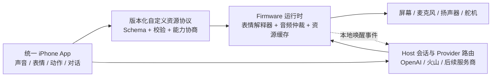

# Robot Evens V0.80 评估与用户自定义平台路线图

- 日期：2026-07-17
- 基线：`firmware/v0.80-accepted` / `9692a15`
- 记录等级：L3（架构、安全和长期产品路线）
- 状态：评估已完成，路线待项目负责人确认；尚未开始改造运行代码

## 1. 结论

V0.80 已经具备一套可用的机器人控制底座：Firmware 的表情、动作、传感器、联网和声音模块相对清晰，Host 有机器人客户端、视觉、MCP 与实时语音适配器，iOS 有连接、姿态控制、动作录制和播放。现有自动测试也能守住大量接口与源代码契约。

下一阶段不适合直接把“声音编辑器、表情编辑器、实时语音”分别堆到现有页面里。应先补一层跨端协议和运行时边界，让手机预览、机器人显示、Host AI 和资源包使用同一种定义。推荐开发顺序是：

1. P0 安全止血：轮换已进入源码的第三方实时语音凭据，移出客户端和 Git 跟踪文件；给机器人局域网控制建立配对与授权边界。
2. 建立版本化的自定义资源协议与设备能力协商。
3. 建立 Firmware 音频会话状态机和分块音频输出，解决麦克风、扬声器、动作和唤醒冲突。
4. 完成声音工作室与表情工作室的最小闭环。
5. 接入本地离线唤醒词和可替换的实时语音 Provider。
6. 把这些能力收口到同一个 iPhone App，而不是另起一个互不兼容的客户端。

## 2. 用户产品计划记录

### 2.1 机器人声音工作室

用户可以在手机录音或导入音频，调整音色、音高、速度、机械感和效果，试听后上传机器人。输出不是任意音频文件，而是一个带版本、格式、时长、校验值和设备兼容信息的资源包。

首版建议支持：

- 录音、文件导入、裁剪、归一化和试听。
- 速度与音高独立调节；至少一个机器人音色效果链。
- 转换为设备统一播放格式，并显示存储、时长和兼容性预算。
- 上传、替换、删除、试听和失败回滚。
- 后续再增加 formant、vocoder、bit-crush、ring modulation 等高级效果。

### 2.2 表情设计与生成器

用户在手机上捏眼睛形状、位置、颜色和图案，建立关键帧并预览动态表情；上传后机器人应尽量逐帧一致显示。表情不能继续只靠 C++ 中增加新的枚举和 `switch` 分支。

首版建议采用版本化的声明式场景格式，包括：

- 画布与设备能力：分辨率、色彩、帧率、最大图元数和内存预算。
- 图层：圆角矩形、椭圆、折线/路径、位图或受控图标图集、裁剪和变换。
- 参数：左右眼形状、开合、眉形、注视点、颜色和透明度。
- 时间线：关键帧、时长、缓动、循环和事件标记。
- 降级规则：设备不支持的图元或效果必须有确定的 fallback。

“Emoji”不能直接假设设备字体可渲染完整 Unicode 彩色 Emoji。首版应使用项目自带、经过授权和体积控制的单色/双色图标图集，并把图标 ID 写入资源包。这样手机和 M5GFX 才能使用同一素材并做像素级校验。

### 2.3 用户自定义机器人 App

沿用当前 `ios/RobotEvensControl` 工程，把它演进为统一 App：连接机器人、声音制作、表情制作、动作时间线、实时对话和设备管理共享同一套连接、权限、资源协议和状态模型。只有出现明确的产品/发布隔离需求时，才考虑拆成第二个 App。

### 2.4 语音唤醒与多 Provider 实时语音

Firmware 目前具备“开启唤醒、进入聆听窗口、被其他事件唤醒”的控制骨架，但没有真正的关键词检测器，不能把它描述成已完成的语音唤醒。

推荐把两件事分开：

- 唤醒词：尽量在机器人本地离线检测，只在命中后启动会话；先做 CoreS3 的内存、CPU、误唤醒和功耗可行性实验。
- 实时语音：通过中立 Provider 接口接 OpenAI、火山或后续服务商，并支持配置选择和失败回退。

OpenAI Realtime 的 VAD 用来判断用户是否开始/停止说话，不是唤醒词。移动客户端适合 WebRTC；服务端到服务端适合 WebSocket。标准 API Key 只能保留在受控的 Host/后端，手机使用后端建立会话或短期凭据。参考 OpenAI 官方的 [Realtime WebRTC](https://developers.openai.com/api/docs/guides/realtime-webrtc)、[Realtime WebSocket](https://developers.openai.com/api/docs/guides/realtime-websocket) 和 [VAD](https://developers.openai.com/api/docs/guides/realtime-vad) 指南。

## 3. 当前实现评估

### 3.1 值得保留的基础

- 已接受基线可定位到 tag 和 commit，运行功能与过程看板边界清楚。
- Firmware 已按硬件、表情、动作、空闲行为、注意力、音频和 API 拆出领域类。
- HTTP 和 iOS Core 有较完整的契约测试；iOS 时间线、姿态和动作模型有真实 Swift 单元测试。
- 音频资源已有 manifest、命名和生成工具，可作为未来资源包迁移的输入。
- 项目管理已支持目标、长期功能、迭代证据、凭据索引和负责人验收。

### 3.2 P0：先处理的安全问题

1. iOS 跟踪源码中存在第三方实时语音应用凭据，测试还固定了这些默认值。应按已暴露处理：在服务商侧撤销/轮换，删除客户端默认值，改由本地配置或后端短期会话下发。是否清理 Git 历史由项目负责人单独决定。
2. 设备 HTTP API 当前缺少配对、认证和请求来源保护，同时允许宽泛的跨域访问；局域网网页可以调用动作、音频、设置及网络管理接口。
3. Wi-Fi 设置相关的修改端点不应在正常运行期始终开放；设置 AP 也不应依赖固定弱口令。

建议的最低安全基线：首次物理确认配对、设备生成随机密钥、每台设备独立凭据、修改操作鉴权、设置模式限时开放、来源限制、速率限制和凭据轮换流程。

### 3.3 表情系统的限制

- Firmware 只有固定 `FaceMood` 枚举和 C++ `switch` 绘制逻辑；新增复杂表情必须重新编译固件。
- `FaceStyle` 主要调整比例、间距、颜色和少量效果，不是通用场景描述。
- `/api/face/list` 返回固定表情列表；iOS UI 暴露的表情还少于 Firmware 支持集合。
- iOS 动作时间线只记录时间和 mood，不能表达几何图层、图标和连续动画参数。
- 当前没有手机预览与机器人渲染的 golden-image 对照测试。

因此“手机和机器人一致显示”的关键不在于手机重写一份相似渲染器，而是共享 schema、素材和固定点/取整规则，再由黄金帧测试校验两个实现。

### 3.4 声音系统的限制

- 当前上传格式固定为 16 kHz、8-bit、单声道 raw PCM，单次容量约 320000 字节，约等于 20 秒。
- 速度调节通过改变播放采样率实现，所以速度和音高耦合，不能视为真正的音色制作。
- 上传内容主要驻留运行内存，重启后不会作为用户资源库保留。
- 情绪声音使用固定槽位；大量生成后的 C++ 音频数组增加固件体积和编译成本。
- Host/iOS 的实时语音输出会先收完整段落、转换、整段上传再播放，不是低延迟分块流；也缺少可靠的打断和回声/会话协调。

应把“编辑工程文件”“可分发资源包”“机器人运行缓存”分成三层，避免把大资源继续编进 Firmware。

### 3.5 唤醒和音频仲裁的限制

- 当前语音唤醒是控制状态和回调骨架，没有关键词模型、误唤醒测试或长期运行验证。
- 主循环中的 voice busy/quiet 状态仍是固定占位值，空闲行为无法知道真实会话是否占用音频。
- 麦克风和扬声器切换存在等待与抢占逻辑，但没有统一的音频会话状态机。

建议状态至少包括 `idle`、`wake-listening`、`capturing`、`thinking`、`speaking`、`interrupted`、`error`，由一个仲裁器拥有麦克风、扬声器、空闲行为和动作提示的控制权。

### 3.6 架构与测试债务

- `firmware/api.cpp`、iOS `AppViewModel.swift` 和 `ContentView.swift` 已成为大文件，后续新增工作室会显著放大耦合；应按 API 域、feature store 和页面拆分。
- Arduino `WebServer` 与部分 Wi-Fi/音频处理是同步阻塞路径，连接和大上传会影响帧率、动作和响应。
- Python 测试中有大量源码字符串/结构契约检查，它们对防回归有价值，但不能证明硬件时序、网络安全、音画一致或真实唤醒质量。
- `standard_settings.json` 中仍有已失效的旧状态端点，项目能力目录此前也没有登记 iOS 已存在的实时语音路径。

## 4. 目标架构

核心边界：

- 自定义资源协议只描述可移植内容，不携带服务商密钥。
- 手机负责编辑体验与高质量预览，Firmware 负责受限、确定性的运行渲染。
- Host 负责云端实时会话、长期密钥、Provider 差异和策略。
- Firmware 在握手时返回能力和预算，App 据此禁止或降级不支持的效果。

## 5. 分阶段交付

### Phase 0：安全与测量基线

- 轮换并迁移已暴露的实时语音凭据。
- 为设备修改 API 制定配对/鉴权方案，Wi-Fi 设置进入限时设置模式。
- 记录音频首包延迟、RAM 峰值、显示 FPS、上传耗时和唤醒 CPU 预算。
- 补硬件冒烟清单，不把源码契约测试等同于真机验收。

### Phase 1：协议与运行时基础

- 定义 `RobotAssetPackage`、`ExpressionScene`、`AudioAsset` 和 capability handshake 的 v1 schema。
- 建立音频会话仲裁器、资源校验和可回滚存储。
- 表情运行时先支持有限图元和关键帧，不追求任意 SVG/CSS。
- 建立 iOS/Firmware 黄金帧和资源包兼容测试。

### Phase 2：两个创作工具 MVP

- 声音工作室：录制/导入、裁剪、速度与音高分离、一个机器人效果链、上传试听。
- 表情工作室：眼睛参数、基础图元、受控图标、关键帧、设备能力提示、上传播放。
- 每个工具必须能保存工程、导出资源包、重新导入并得到一致结果。

### Phase 3：本地唤醒和实时语音

- 先做本地 wake-word 技术 spike，验收误唤醒、漏唤醒、CPU、RAM 和安静功耗；不可行时保留按键/接近/手机触发。
- 建立 Provider 中立事件模型，再把现有火山适配器和 OpenAI Realtime 分别接入。
- 机器人输出改为分块缓冲，支持首包播放、barge-in、超时和断线恢复。
- iOS 需要直接参与实时会话时使用 WebRTC；Host 侧服务连接使用 WebSocket。

### Phase 4：统一 App 和用户产品化

- 完成设备配对、资源库、版本迁移、备份/恢复和多机器人管理。
- 增加模板、分享包、兼容性检查和受控导入，禁止资源包携带可执行代码。
- 最后再做账号、云同步和公开分享；在此之前全部保持本地优先。

## 6. 验收门槛

### 声音

- 同一资源在 App 预览和机器人播放的时长误差、峰值和响度在约定范围内。
- 速度变化不再强制改变音高；失败上传不会破坏上一个可用资源。
- 实时语音可测量首包延迟，支持用户打断并在断线后回到确定状态。

### 表情

- schema 有明确版本和迁移策略；未知字段按规则忽略或拒绝。
- 关键黄金帧在 iOS 和 Firmware 的差异低于约定阈值。
- 超预算资源在上传前被 App 拒绝，Firmware 仍会独立校验。

### 唤醒

- 在目标房间噪声、播放自身声音和多人说话条件下记录误唤醒/漏唤醒。
- 唤醒期间不会与扬声器、空闲动作或实时会话互相抢占到死锁。
- 唤醒失败时始终保留物理或 App 手动入口。

### 安全

- App 和仓库中不存在长期第三方密钥；服务商侧完成旧凭据轮换。
- 未配对设备不能执行修改操作；设置模式有物理入口和自动超时。
- 自定义资源经过大小、格式、校验和与路径安全验证。

## 7. 本次评估验证与边界

- Python 全量测试：353 个通过。
- Swift Package 测试：70 个通过。
- Arduino Firmware 编译：作为本次基线核验单独记录到迭代节点。
- iOS 无签名模拟器构建：当前 Xcode SDK 与已安装 Simulator runtime 版本不一致，需在环境补齐后重跑。
- 未连接真机，因此语音唤醒、音频首包、屏幕帧率、局域网攻击面和黄金帧尚未完成硬件验证。

## 8. 回滚

本次只增加路线图、目标、功能依赖、评估节点和无明文凭据风险记录，不修改 Firmware、Host 或 iOS 运行代码。若项目负责人不接受该规划，可删除新增路线图和对应目标/功能/迭代节点，恢复项目能力目录与凭据索引，然后重新导出 `project_summary.json`；V0.80 运行基线不受影响。
