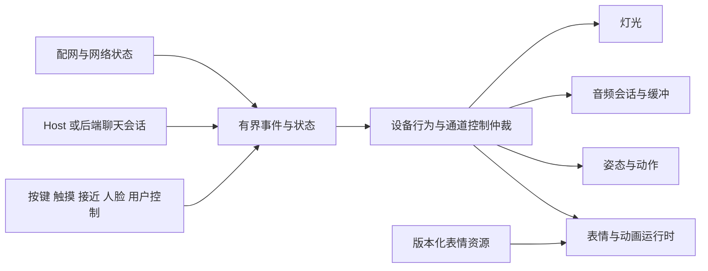

# Robot Evens 固件现状与重整方案

日期：2026-10-07。状态：方案已交付，待项目负责人讨论和验收。

机器人接下来要解决的核心问题，是把设计的表情可靠地显示出来，让联网、对话、注意力和日常动作协调工作，并降低第一次连接的操作成本。应先对齐设备、代码和功能记录，再建立可加载的表情资源与明确的控制权，随后接入聊天服务。

本轮交付覆盖现状、备份、架构边界、实施顺序和验收标准。旧方案和素材保留用于溯源与回滚；新设计从本轮产品需求重新确定。固件改造和新素材制作属于后续迭代。

## 当前设备与代码基线

| 对象 | 本轮确认的事实 | 对后续工作的影响 |
| --- | --- | --- |
| Git 已接受基线 | `firmware/v0.80-accepted` 对应提交 `9692a15` | 继续作为已接受回滚点 |
| 当前工作区 | `firmware_version.h` 标记 V0.81；存在固件、iOS 和管理文件的未提交修改 | 实施前保存当前工作区，不用旧版本覆盖现有修改 |
| 当前可访问设备 | `deskbot.local` 的只读状态接口返回 V0.80，硬件就绪，表情目录为 15 个固定 mood | 与工作区 V0.81 有差异；刷写前需把设备身份与屏幕版本对上 |
| 当前固件表情代码 | `face_renderer.*` 使用固定枚举和几何绘制；自定义眼形相关的两个生成头文件缺失 | 旧眼形编辑器的设计不能直接上传到这份固件 |
| 当前设备表情接口 | `GET /api/face/library` 返回 HTTP 404 | 自定义表情库闭环在该设备上不可用 |
| 当前 iOS 工程入口 | `RobotEvensControlApp.swift` 打开 `DesktopRobotAppView` | 日常入口只有连接、常用表情、动作和设置；旧创作界面仍保存在工程中 |
| 功能记录 | 仍有“共享眼型已部署”的描述和多个待验收节点 | 本轮修正当前能力登记，历史交付记录继续保留 |

可访问设备代表本轮访问到的实例。项目以前的 V0.81 部署记录属于历史证据，不能用来推断这台设备的当前版本。当前工作区也没有完整重建、刷写到该设备。

## 表情为什么难以落地

### 当前能力范围

固件支持 neutral、happy、angry、sad、sleeping、tired、surprised、love、dizzy、wink、dead、thinking、curious、sunglasses、loading 共 15 种固定表情。宽高、眼距、位置、颜色、发光和扫描线参数可以调整；眨眼、呼吸和部分旋转效果由 C++ 逻辑生成。全屏特效目前只有程序绘制的 matrixRain。

这套能力适合调整现有眼睛，缺少任意图片加载、独立表情资源 ID、逐帧动画播放和资源安装协议。因此新增图片或复杂动画会涉及运行时能力，单独增加绘画无法完成显示闭环。

手机端仍有 `EyeShapeDesign`、参考图提取、蒙版预览以及 `/api/face/library`、`/api/face/preview` 等请求封装；当前固件已没有对应实现。手机本地预览成功，无法证明机器人可以播放。

还有一处确定的名称错误：`assistant_status.cpp` 在状态源离线时调用 `setMood("confused")`，但渲染器只识别上述 15 个名称。`setMood` 遇到未知名称会回退 neutral 并返回 false，调用方没有处理结果。后续应统一名称登记与能力协商，并避免拒绝请求时悄悄改变当前画面。

### 重整后的表情能力

首版建议提供三种表达方式，共用一个版本化资源包：

| 方式 | 用户能做什么 | 固件如何运行 |
| --- | --- | --- |
| 参数眼形 | 调整注视、开合、颜色和日常微表情 | 使用有界几何参数，持续响应本地行为 |
| 位图场景 | 显示新绘制的左右眼、嘴、符号或完整画面 | 播放经过转换和校验的设备资源 |
| 帧动画与参数时间线 | 循环动画、过渡、眨眼和情绪短片 | 按时间戳播放，支持停止、超时和恢复默认表情 |

表情资源使用独立 `expressionId`。旧 mood 名称保留为兼容别名，情绪、设备状态与显示内容分别表达，避免每新增一张图都扩展固件枚举。

资源包至少声明版本、ID、画布、表示方式、帧数或时间线、时长、循环规则、资源校验值、所需能力和预算。原始图片是创作文件；安装包是设备可播放的文件。PNG、绘图工程或视频素材先经过转换，再生成设备支持的有限格式。首版采用 RGB565、索引色或蒙版中的经实测方案，避免要求 ESP32 接受任意媒体格式。

手机与设备必须使用相同的画布、素材、坐标和取整规则。上传前进行兼容检查，设备安装到暂存区，校验通过后切换资源版本；失败时继续播放上一版。设备回报当前资源 ID、版本和播放状态，手机再显示“已生效”。

当前画布为 320×240，16 位完整画面需要 153,600 字节。若按 30 帧每秒保存原始全屏帧，数据量约为 4.61 MB 每秒；这只是格式计算，不是设备已经达到的性能。因此要测量 RAM、存储和解码时间，再选择压缩、局部帧或参数动画。首批新素材先覆盖常态、倾听、思考、说话和一个较复杂的全屏短动画，用真机证明能力范围后再扩充。

## 行为架构与生命力

### 当前冲突来源

固件已经按硬件、表情、动作、空闲、接近、摄像头、声音和联网拆出模块。主要问题在模块之间的协调：多个控制器可以直接修改表情和姿态，主循环依靠 `active()` 判断和调用顺序处理冲突，控制权的获得、取消与恢复没有统一协议。

`firmware.ino` 中的 `voiceQuietMode` 和 `voiceBusy` 仍固定为 false。实际对话会话无法通过这些变量占用声音和动作通道。助手状态模块还会在主循环里同步请求 Host，网络超时可能延迟本地动画和行为；Wi-Fi 连接也有同类阻塞问题。

### 建议的模块边界

按屏幕、舵机、声音、灯光分别登记控制者、优先级、有效期和取消方式。配网界面主要占用屏幕；对话可以占用声音并驱动说话表情；用户手动姿态与自主动作冲突时有明确的处理规则。一个模块提出意图，由仲裁层决定是否执行。

设备模式、对话阶段和情绪分开保存。例如设备保持正常运行，对话处于 speaking，情绪为 happy，表情播放某个自定义资源。建议优先级从硬件保护、用户停止和手动控制，到对话、情绪动作、注意力、空闲行为；每个通道的具体规则随产品需求确定。

“生命力”先落到可观察的行为：离线时仍能自然眨眼、看向用户、回应触摸和进入睡眠；联网对话时有倾听、思考、说话、打断和恢复；异常时保留明确反馈。云端模型负责内容和高层意图，本地负责及时反应、动作边界和断网后的行为。

重整时先给现有模块增加事件与控制权边界，再拆分过大的 API 文件。网络请求、上传和音频等待改为有界异步工作，避免先全面重写所有驱动。

## 首次配网与重连

### 当前操作与代码问题

当前 V0.81 源码的首次设置流程包含三击电源键、进入系统 Wi-Fi 切换热点、打开页面或 App、手填 SSID 和密码、切回目标网络、再次连接机器人。启动联网失败后，代码等待用户手动打开设置热点。App 没有设备发现流程，日常入口与旧 Core 客户端还使用不同的默认地址约定。

`connectToNetwork` 在同步循环里等待，设置 API 默认等待 15 秒；失败后恢复旧网络另有 6 秒等待。此路径由 `server.handleClient()` 调用，会占用主循环。具体停顿时长取决于网络结果，需要后续真机计时。

设置网页还有错误反馈风险：`renderStatus` 只根据 `connected` 显示成功。如果尝试新网络失败，但成功恢复旧网络，返回值可能同时为 `ok=false` 和 `connected=true`，网页会把旧网络恢复显示成连接成功。反馈必须区分目标网络连接结果与设备当前连接状态。

### 建议的用户流程

1. 首次无配置时自动显示设置向导，并开启有时限的设置入口。已有配置但暂时断网时采用重试和清晰恢复入口，避免每次短暂断网都要求重新配网。
2. 屏幕显示明确的操作步骤，App 引导用户连接设置热点。二维码可作为减少输入的辅助入口；BLE 配网是否加入，另做 CoreS3 与 iOS 的可行性验证。
3. 网络列表可供选择，手动输入用于隐藏网络。扫描与连接在后台进行，界面能显示进度、取消和重试。
4. 提交后立即返回连接任务 ID，通过状态查询显示“连接中”“目标网络已连接”或具体失败原因。新配置在验证成功后才成为保存的配置。
5. 成功后保留足够的设置确认窗口，引导手机返回原网络，通过设备身份和服务发现重新找到机器人。App 实际探测到设备后，再确认设置完成并关闭设置入口。
6. 物理恢复入口继续保留；配对、设备身份、多个机器人的名称冲突和配置重置形成一套流程。

mDNS 名称只是发现线索，还需要稳定的设备 ID 和已配对设备记录。新 API 需同时提供协议版本和能力列表，避免手机把“网络已连上”等同于“所有机器人功能均可用”。

## 后续 OpenAI 与 Chatbot 接入

首轮接入沿用现有 Host 位置，增加中立的会话接口。文字对话可先验证“用户消息 → 回复文本 → 有界表情或动作指令”的闭环；实时语音随后接入分块音频、打断和恢复。

OpenAI 官方 Realtime 文档说明，其语音会话支持工具调用，浏览器侧常用 WebRTC，服务端侧可用 WebSocket，并由应用服务端建立短期客户端凭据。该能力适合作为 Provider 适配器的输入，机器人侧只接收中立状态和受约束动作。[OpenAI Realtime 官方文档](https://developers.openai.com/api/docs/guides/realtime)

具体边界建议如下：

- Host 或后端保存长期服务商密钥、处理会话与模型差异，输出 listening、thinking、speaking、interrupted、ended、error 等统一事件。
- 设备音频层负责输入输出缓冲、首包播放、停止、超时与本地行为恢复。
- 模型可调用明确的表情 ID 和有界动作，设备验证资源存在性、参数范围和当前控制权。
- App 负责配对、连接、配置和用户界面；独立于具体 Provider 的设备协议保持稳定。

是否要求机器人脱离电脑运行，是实现前需要明确的产品选择。若要求独立运行，应把 Host 职责部署到常驻后端或其他网关，并验证设备音频传输预算。关键词唤醒也需要单独实现和验证；现有监听开关与状态接口没有证明离线唤醒已经完成。

## 实施顺序与验收标准

| 阶段 | 交付范围 | 必须能验收的结果 |
| --- | --- | --- |
| 0 基线对齐 | 确认目标设备身份、固件版本、源码快照、能力表和测试缺口 | 能明确当前运行的是哪份固件；新刷写前具有设置快照和可恢复镜像 |
| 1 表情播放闭环 | 资源格式、能力接口、图片与短动画安装和播放、手机预览 | 新素材在真机显示；左右不对称、透明边缘、帧序和循环一致；坏包拒绝；断电重启后可恢复；可退回上一版 |
| 2 行为控制与配网 | 通道仲裁、非阻塞网络状态、首次设置向导、发现与重连 | 配网期间按键和画面仍响应；手动控制与自主动作有明确优先级；错密码与旧网络恢复分别提示；App 回到正确设备 |
| 3 聊天闭环 | Provider 接口、会话状态、文字指令，再到实时音频 | 倾听和说话状态与会话一致；可打断；断网和超时可恢复；空闲声音不抢占对话 |
| 4 扩充生命力 | 用户确认的个性、习惯、更多动作与新素材 | 行为频率自然、能解释触发条件、设置可保存且可撤回 |

性能先记录基线，再确定帧率、首包延迟、响应时延和连续运行的门槛。表情阶段必须包含真机显示与导出画面的对照；源码字符串测试只负责部分接口回归。

下一轮优先明确：哪些功能是必须保留的日常体验；表情需要眼形、完整面部还是全屏动画；“生命力”偏向陪伴互动还是桌面任务状态；聊天是否允许依赖常驻电脑。随后把第一阶段拆成可实现的资源协议和最小播放原型。

## 备份核验与回滚边界

| 备份 | 核验结果 | 用途与限制 |
| --- | --- | --- |
| `backups/firmware-V0.80-device-baseline-20260717-003806/` | `SHA256SUMS` 中 8 个构建和设备区段文件全部匹配 | V0.80 回滚包；本轮核验完整性，恢复效果仍需实际恢复验收 |
| 同名 `.tar.gz` 与 `.tar.gz.sha256` | 压缩包哈希匹配，204 个归档成员可读取，包含源码与构建镜像 | 已有备份继续保留 |
| `backups/firmware-source-pre-v080-restore-20260720.tar.gz` | 压缩包可读取，包含 6 个实验源码或头文件以及附带元数据 | 表情实验的局部源码备份；不包含完整 `firmware.ino` 或可刷写镜像 |
| `backups/robot-device-settings-20260719-post-approved-pair-geometry.json` | JSON 可解析 | 历史设置快照，不能替代今天目标设备的设置快照 |
| 若干旧分段 app0 文件与零字节校验表 | 不作为完整回滚依据 | 使用上面的完整 V0.80 包作为已核验依据 |

本轮只进行设备 GET 请求，保留设备现有配置和画面。现有设置采集工具会切换全部 mood，且要求当前设备不存在的 `/api/face/library`；后续设置备份应先兼容设备能力，再执行采集。

管理记录修改前的文件保存于 `artifacts/firmware-review-20261007/before-management/`，附带逐文件校验值。撤回本轮整理时，恢复其中对应的管理文件和功能速查文档，移除本轮新增架构文档，再执行 `python3 -m host.process_board_server --export-summary`。若此后产生新迭代，应按本轮节点和字段回退，避免覆盖后续记录。

## 本轮验证结果

| 检查 | 结果 |
| --- | --- |
| 本地看板修改前结构检查 | 通过 |
| V0.80 备份内部及压缩包校验 | 通过 |
| 设备只读接口 | ping、status、face/list、setup/status、catalog/assets、mumble/status、listening/status 可访问；face/library 返回 404 |
| `tests.test_firmware_version` | 1 项通过 |
| `tests.test_firmware_standard_settings` | 2 项通过 |
| `tests.test_firmware_source` | 执行 180 项测试，产生 14 条断言失败记录与 2 条文件缺失错误；部分断言为同一测试的子测试 |
| `tests.test_eye_glyph_assets` | 2 项中 1 项通过、1 项失败；跨端生成资产与当前固件不一致 |
| `tests.test_robot_settings_capture` | 3 项通过；模拟测试不能证明当前设备采集流程兼容 |
| `tests.test_process_board_server` | 15 项通过 |

固件源码失败涉及已回退的眼形库、曲线、临时预览、生成头文件，以及部分旧绘制断言。这些缺口已单独登记为“未解决问题”，下一步按新功能计划重新确定对应测试的期望。缺少运行时能力时不应仅删除失败断言。

本轮没有修改 Firmware、Host 或 iOS 运行代码，Arduino 编译和 iOS 构建留在对应实现迭代执行。上述结果验收的是梳理与方案，不能作为新固件发布或新表情运行时已完成的证明。
